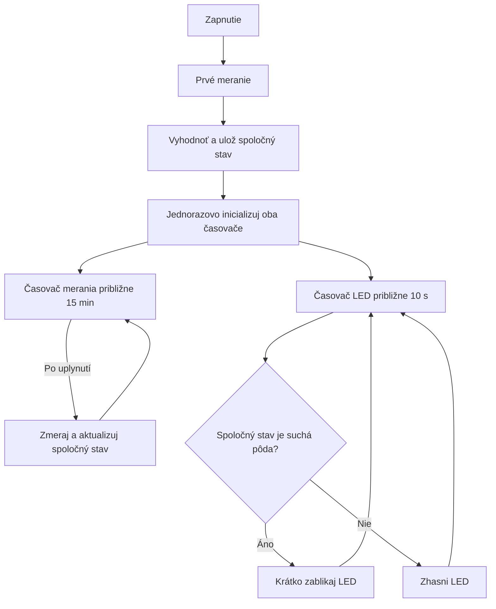

---
# 🧩 Versioning – systém dopĺňa automaticky
fm_version: "1.0.1"

# Dátum buildu – generuje skript
fm_build: "2026-10-27T16:40:37.448310+00:00"

# Poznámka k verzii – voliteľné
fm_version_comment: ""

# 🆔 IDENTITY --------------------------------------------------------

# ID generuje CLI / skript

# Unikátne UUID – generuje skript
guid: "0defb2a3-5971-45de-b3e9-2443a83f6cb2"

# 🧭 CONTEXT ---------------------------------------------------------

# DAO / doména (knife, sdlc, q12, 7ds...) dopĺňa skript
dao: "sthdf"

# Názov zápisu – dopĺňa používateľ
title: "03 Design"

# Krátky popis – dopĺňa používateľ (voliteľné)
description: "Predbežný návrh správania indikátora a časovania."

# 👥 AUTHORSHIP ------------------------------------------------------

# Hlavný autor – z globálneho configu
author: "Tomáš Jucha"

# Zoznam autorov – generuje skript
authors:
  - "Tomáš Jucha"

# 🗂 CLASSIFICATION ---------------------------------------------------

# Nadradená kategória – môže doplniť používateľ
category: ""

# Typ dokumentu (guide, case, tutorial...) – používateľ (voliteľné)
type: ""

# Priorita (low/medium/high) – voliteľné
priority: ""

# Tagy – odporúča sa 2–6 tagov.
# Typy tagov:
#   - rámce: knife, 7ds, sdlc, q12
#   - účel: tutorial, guide, pattern, case-study
#   - téma: git, backup, ai, communication
#   - úroveň: beginner, intermediate, advanced
tags: [sdlc, navrh, casovanie]

# 🌍 LOCALIZATION -----------------------------------------------------

# Jazyk dokumentu – doplní skript podľa štruktúry
locale: "sk"

# 🕒 LIFECYCLE --------------------------------------------------------

# Dátum vytvorenia – generuje skript
created: "2026-10-27 17:40"

# Dátum poslednej úpravy – dopĺňa človek
modified: "2026-11-24"

# Stav dokumentu – default "backlog"
status: "inprogress"

# Viditeľnosť – default "public"
privacy: "public"

# ⚖ INTELLECTUAL PROPERTY -------------------------------------------

# Držiteľ práv k obsahu – dopĺňa skript
rights_holder_content: "Roman Kazicka"

# Systémový vlastník práv
rights_holder_system: "CAA / KNIFE / LetItGrow"

# Licencia
license: "CC-BY-NC-SA-4.0"

# Disclaimer
disclaimer: "Use at your own risk. Methods provided as-is; participation is voluntary and context-aware."

# Copyright
copyright: "© 2025 Roman Kazicka"

# 🔗 ORIGIN / PROVENANCE ---------------------------------------------

# Repozitár pôvodu
origin_repo: ""

# URL pôvodného repozitára
origin_repo_url: ""

# Commit pôvodu
origin_commit: ""

# Branch pôvodu
origin_branch: ""

# Systém pôvodu (CAA/KNIFE/STHDF…)
origin_system: "CAA"

# Pôvodný autor
origin_author: "Roman Kazicka"

# Importovaný zdroj
origin_imported_from: ""

# Dátum importu
origin_import_date: ""

# 🧱 RESERVED ---------------------------------------------------------

fm_reserved1: ""
fm_reserved2: ""
---

<!-- SDLC_INSTANCE_ID: ST-059-IndikatorVlhkosti -->

# 03 – Návrh

**Stav:** predbežný návrh; konkrétne zapojenie a rozmery sa určia po doručení dielov.

Senzor poskytne analógový údaj doske ESP32. Program údaj pravidelne vyhodnotí oproti hranici nastavenej v kóde a pri suchom stave aktivuje červenú LED. Elektroniku a batériu má chrániť vlastný 3D tlačený kryt; meracia časť senzora bude v pôde.

Navrhované intervaly 15 minút pre meranie a 10 sekúnd pre blikanie sú predbežné. Riadenie spánku musí umožniť oba časové intervaly; spôsob prebúdzania a spotrebu treba navrhnúť a otestovať. Jednoduchá výmena senzora je voliteľné vylepšenie; konektor a mechanika sú otvorené.

## Predbežné správanie

Meranie a signalizácia majú samostatné časovače. Schéma vyjadruje ich logickú súbežnosť; nepredpisuje konkrétnu implementáciu ani režim spánku.

Pri ďalšom meraní sa aktualizuje spoločný stav; časovač LED beží nezávisle od časovača merania. Hraničná hodnota sa považuje za suchú podľa kalibrovanej podmienky; smer porovnania závisí od nameraných hodnôt senzora. Najskôr sa overí základná funkčnosť, až potom sa bude riešiť optimalizácia spotreby.

Blokové vzťahy: [architektúra](./architecture-diagram.md). Konkrétne piny, ochrana vstupov a spôsob napájania senzora zostávajú otvorené do overenia skutočných komponentov.

---
**Navigácia:** [⬆️ Späť](../index.md)
